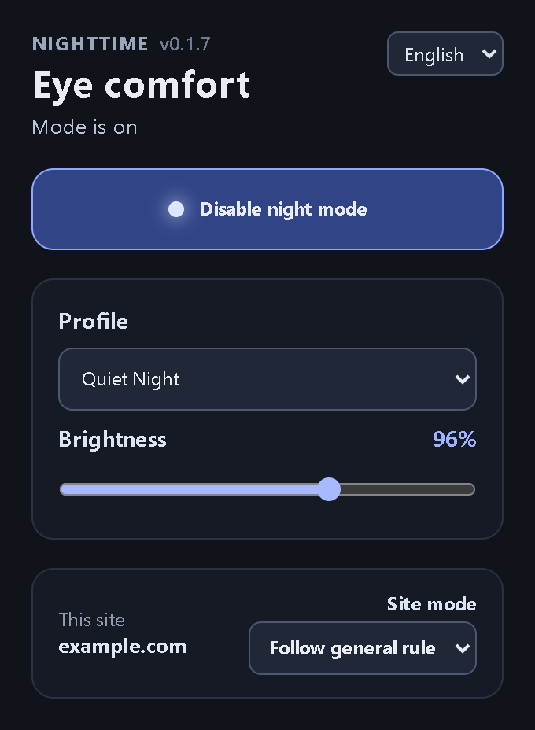

# NightTime — Dark Mode for Every Website

English | [Русский](README.ru.md)

Smart dark mode, night filter and eye-comfort settings for every website.

NightTime is a browser extension that adapts website colors for more comfortable viewing in dark environments. It combines a locally bundled Dark Reader engine with color profiles, brightness controls, site-specific settings, and a developing Smart Dark readability layer. The interface is available in English and Russian.



## Features

- Dark mode powered by the locally bundled Dark Reader engine.
- Seven color profiles, brightness adjustment, Night Shift, and scheduling.
- Per-site settings: follow general rules, always enable, or always disable.
- English and Russian interface with automatic language selection.
- Settings are stored locally; the extension does not include analytics or remote JavaScript.
- Smart Dark text-readability analysis is under active development.

## Development

```text
npm ci
npm run lint
npm run typecheck
npm run test
npm run build
npm run zip
```

After `npm run build`, the unpacked extension is in `.output/chrome-mv3`. The `npm run zip` command creates an archive for the Chrome Web Store.

To run E2E tests, install Playwright Chromium once, then run the test:

```powershell
npm exec playwright -- install chromium
$env:RUN_EXTENSION_E2E='1'; npm run test:e2e
```

To regenerate the localized popup screenshots, build the extension and run `node scripts/capture-readme-screenshots.mjs`.

Before release, run `npm run test:all`, `npm run test:e2e`, and the manual checks in [the release checklist](docs/RELEASE_CHECKLIST.md).

## License

Copyright (c) 2026 Abdurakhman Urusov. NightTime is licensed under the [PolyForm Strict License 1.0.0](LICENSE). It permits noncommercial use, including personal use, but does not grant permission to distribute or modify the software. See the license for its complete terms, including provisions for certain noncommercial organizations. Third-party components retain their own licenses; see [third-party notices](THIRD_PARTY_NOTICES.md).
