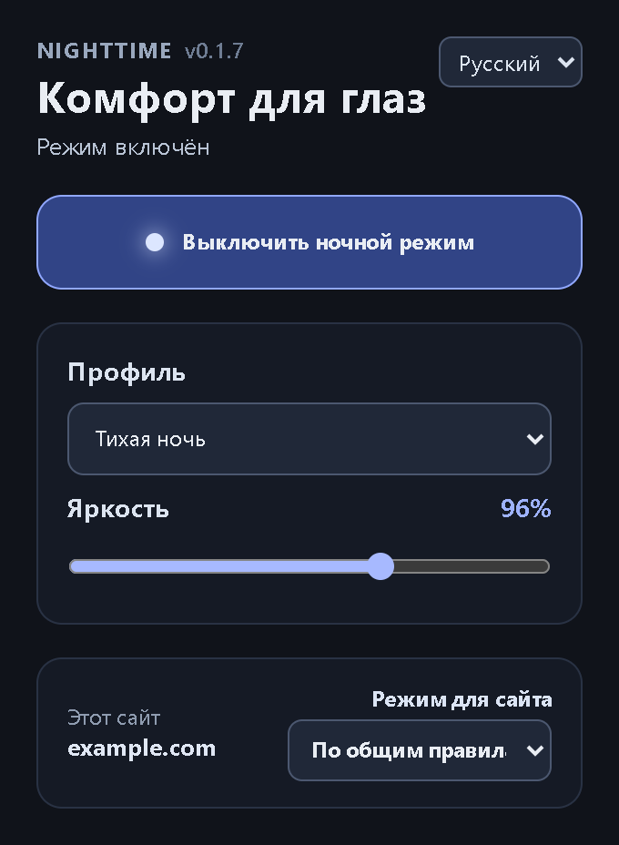

# NightTime — тёмный режим для сайтов

[English](README.md) | Русский

Тёмный режим, ночной фильтр и комфортная настройка цветов для любых сайтов.

NightTime — браузерное расширение, которое адаптирует цвета сайтов для комфортного просмотра в тёмное время суток. Оно сочетает локально встроенный движок Dark Reader, цветовые профили, настройку яркости, индивидуальные правила сайтов и развивающийся слой улучшения читаемости Smart Dark. Интерфейс доступен на русском и английском языках.



## Возможности

- Умное затемнение страниц на базе локально встроенного Dark Reader.
- Семь профилей, регулировка яркости, Night Shift и расписание.
- Отдельные правила для сайтов: общие настройки, всегда включать или всегда выключать.
- Русский и английский интерфейс с автоматическим выбором языка.
- Настройки хранятся только локально; аналитики и удалённого JavaScript нет.
- Анализ читаемости текста Smart Dark находится в разработке.

## Разработка

```text
npm ci
npm run lint
npm run typecheck
npm run test
npm run build
npm run zip
```

После `npm run build` распакованная версия находится в `.output/chrome-mv3`. Команда `npm run zip` создаёт архив для загрузки в Chrome Web Store.

Для E2E один раз установите Chromium Playwright и затем запустите тест:

```powershell
npm exec playwright -- install chromium
$env:RUN_EXTENSION_E2E='1'; npm run test:e2e
```

Чтобы обновить скриншоты интерфейса на обоих языках, соберите расширение и выполните `node scripts/capture-readme-screenshots.mjs`.

Перед публикацией выполните `npm run test:all`, `npm run test:e2e` и ручную проверку из [списка проверки релиза](docs/RELEASE_CHECKLIST.md).

## Лицензия

Copyright (c) 2026 ar.urusoff. NightTime распространяется на условиях [PolyForm Strict License 1.0.0](LICENSE). Лицензия разрешает некоммерческое, в том числе личное использование, но не предоставляет права распространять или изменять программу. Полные условия, включая положения для отдельных некоммерческих организаций, приведены в тексте лицензии. Сторонние компоненты сохраняют собственные лицензии; см. [уведомления о стороннем ПО](THIRD_PARTY_NOTICES.md).
